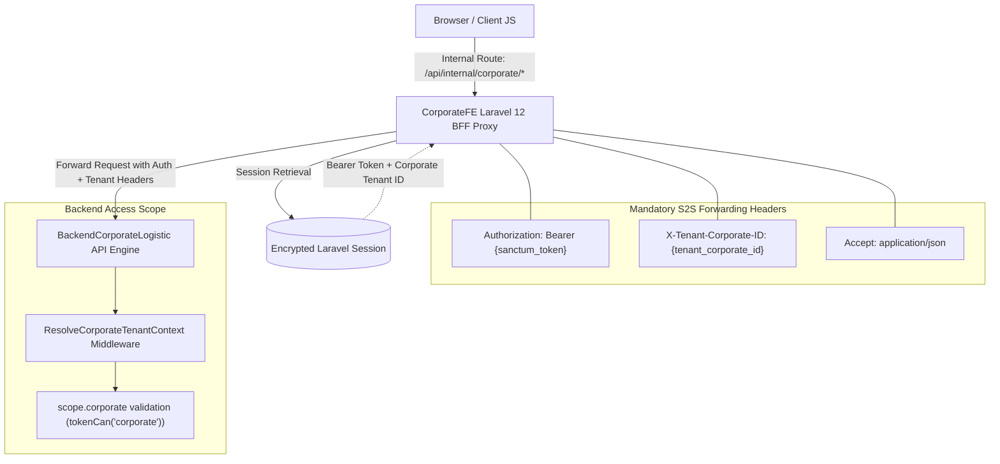

# 01. CorporateFE Architectural Blueprint & BFF Pre-Plan
## Enterprise Multi-Tenant Frontend Architecture & Backend-For-Frontend Proxy Specification

> **Target Directory:** `d:\DevMuncen\CorporateFE/docs/01_preplan/01_CORPORATEFE_PREPLAN.md`  
> **Backend Engine:** `d:\DevMuncen\BackendCorporateLogistic` (`/api/corporate/*`, `/api/master/*`, `/api/auth/*`)  
> **Base Template & UI Engine:** Laravel 12 + Tailwind CSS v4 + Preline UI + Vanilla JS BFF Engine (Parity with `LogisticFE` & `AgregatorFE`)  
> **Tenant Identity:** Corporate Enterprise Shipper (`Korporasi Merah Putih`, `tenant_corporate_id: 1`)  
> **Development Port Standards:** `CorporateFE` = `http://localhost:8004`, `BackendCorporateLogistic` = `http://localhost:8001`

---

## 1. Executive Summary & Core Mission

**`CorporateFE`** is the dedicated enterprise web operations and management portal for **Corporate Shippers (Prinsipal Korporasi / Manufaktur / National Shippers)**. It empowers corporate logistics directors, warehouse managers, inventory controllers, and finance executives to:

1. **Govern Corporate Master Data**:
   - Master Product Catalog with categories, units of measure (UOM), default prices, and specific **Cargo Type classifications** (`cargo_type_id`).
   - Corporate Warehouses & Manufacturing Plants with Kemendagri city codes, geo-coordinates, and **Pickup Hub flags** (`is_pickup_hub`).
   - B2B Corporate Customers, Distribution Networks, and Supply Vendors.
2. **Execute Multi-Drop Request Orders (RO Wizard)**:
   - Plan shipments with sequential multi-drop stops (`delivery_points[]`).
   - Encapsulate products strictly inside `delivery_points[].items[]`.
   - Autofill drop points directly from pending **Distributor Purchase Orders (`distributor_orders`)**.
   - Query available carrier contracts and routes dynamically via `POST /api/corporate/request-orders/inquire-routes`.
   - Lock in negotiated freight tariffs dynamically with `POST /api/corporate/request-orders/calculate-pricing` stored as an immutable **`snapshot_pricing`** audit trail.
3. **Monitor Child Waybills & End-to-End Live Tracking**:
   - Track auto-spawned child waybills (`AWB-...-S{seq}`) generated for each delivery point.
   - Inspect live transit milestones, driver telemetry, **Bukti Pickup (`pickup_proof_photo`)**, and **Proof of Delivery (`pod_proof_photo`)**.
   - Print individual Surat Jalan layouts (`GET /api/corporate/waybills/{id}/print`).
4. **Synchronize Inventory Movements**:
   - Track physical stock levels (`corporate_product_stocks`).
   - Monitor automatic **Item Out (`CorporateItemOut`)** triggers upon carrier pickup from a Corporate Warehouse.
   - Monitor automatic **Item In (`CorporateItemIn`)** triggers upon carrier delivery to a Corporate Warehouse.
   - Record manual goods receipts, factory item outs, and stock opnames.
5. **Manage Distributor Billing & Invoicing**:
   - Issue and track distributor invoices (`/api/corporate/finance/distributor-invoices`).
   - Form dependencies and multi-order invoice aggregation.

---

## 2. Multi-Tenant Architecture & BFF Proxy Model

### 2.1 Backend-For-Frontend (BFF) Security Standard
- **Zero Token Leakage:** Sanctum bearer tokens and secret corporate tenant IDs are **never** stored in browser `localStorage`, `sessionStorage`, or client-accessible cookies.
- **Encrypted S2S Storage:** Upon login via `POST /api/auth/login` (`portal_type: "corporate"`), the token, corporate ID, and user profile are encrypted and stored in Laravel session (`session('api_token')`, `session('tenant_corporate_id')`).
- **Header Injection (`ProxyController.php`):** All client AJAX calls target internal `/api/internal/corporate/*` routes. The BFF proxy controller intercepts and forwards requests to `BackendCorporateLogistic` while injecting:
  - `Authorization: Bearer {token}`
  - `X-Tenant-Corporate-ID: {corporate_id}`
  - `Accept: application/json`

### 2.2 Unconstrained Modal Stacking Hierarchy
To prevent fixed modal backdrops and selection pickers from becoming trapped or occluded by page content:
- The root `
` is kept free of arbitrary `z-10` stacking contexts.
- Strict z-index layers across components:
  - **Backdrop overlay (`.hs-overlay-backdrop`):** `!z-[40]`
  - **Standard form modals (`<x-modal>`):** `!z-[60]`
  - **Relational lookup pickers (`<x-modal-picker>`):** `!z-[80]`
  - **Notifications & Toasts (`<x-toast>`):** `!z-[100]`

---

## 3. Core Functional Domains & Endpoints

| Domain | Key Endpoints / Capabilities | Backend Target (`BackendCorporateLogistic`) |
| :--- | :--- | :--- |
| **Authentication** | `POST /login`, `POST /logout`, `GET /me` | `POST /api/auth/login` (`portal_type: 'corporate'`), `POST /api/auth/logout`, `GET /api/auth/me` |
| **Dashboard** | Mobile & Web Dashboard Summary, Real-time metrics | `GET /api/corporate/dashboard/mobile`, `GET /api/corporate/mobile/dashboard/summary` |
| **Products & Catalog** | Product Catalog, Categories, UOMs, Cargo Types | `/api/corporate/products`, `/product-categories`, `/uoms`, `/api/cargo-types` |
| **Warehouses & Plants** | Origin Hubs, Factory Plants, Kemendagri city codes | `/api/corporate/warehouses` (with `is_pickup_hub` flag) |
| **Partners & Network** | B2B Customers, Distributors, Supply Vendors | `/api/corporate/customers`, `/corporate/vendors`, `/corporate/distributors` |
| **Request Orders (RO)** | Multi-Drop Wizard, Route Inquiry, Dynamic Pricing | `POST /api/corporate/request-orders/inquire-routes`, `POST /calculate-pricing`, `/request-orders` |
| **Distributor POs** | Distributor Orders Indexing & RO Autofill | `GET /api/corporate/distributor-orders?city_code={code}` |
| **Waybills & Tracking** | Child Waybill Monitor, Printable Resi, Photo Proofs | `/api/corporate/waybills`, `/waybills/{id}/tracking`, `/waybills/{id}/print` |
| **Inventory Movements** | Internal Item In / Item Out, Stock Ledger | `/api/corporate/item-ins`, `/api/corporate/item-outs`, `/corporate/inventory/*` |
| **Distributor Invoices** | Distributor Billing, Form Dependencies | `/api/corporate/finance/distributor-invoices`, `/form-dependencies` |

---

## 4. Port & Development Environment Configuration

| Service | Local URL / Port | Technology | Notes |
| :--- | :--- | :--- | :--- |
| **`BackendCorporateLogistic`** | `http://localhost:8001` | Laravel 12 (REST API) | Multi-tenant core API engine |
| **`CorporateFE`** | `http://localhost:8004` | Laravel 12 + Vite | Corporate Shipper Web Portal |
| **`LogisticFE`** | `http://localhost:8003` | Laravel 12 + Vite | Logistics Carrier Web Portal |
| **`AgregatorFE`** | `http://localhost:8002` | Laravel 12 + Vite | Central Aggregator Hub Portal |
