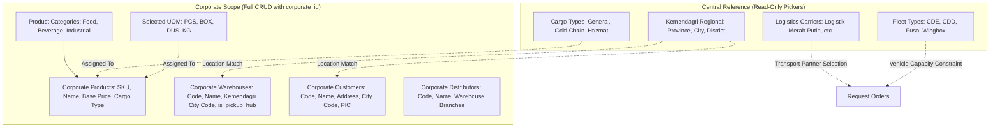

# 02. CorporateFE Master Data Foundation & Tenant Governance Specification
## Master Data Prerequisites, Ownership Demarcation & Regional Code Standards

> **Target Directory:** `d:\DevMuncen\CorporateFE/docs/01_preplan/02_CORPORATEFE_MASTER_DATA_SPEC.md`  
> **Backend Engine:** `d:\DevMuncen\BackendCorporateLogistic` (`/api/corporate/*`, `/api/master/*`)  
> **Tenant Governance Rule:** **CRUD is STRICTLY limited to entities owned by `corporate_id`.** All central reference data (Logistics Carriers, Cargo Types, Fleet Types, Kemendagri Regional Codes) is **READ-ONLY** in `CorporateFE`.

---

## 1. Master Data Governance & Authority Matrix

In accordance with enterprise multi-tenant isolation, data entities in `CorporateFE` are categorized into two strict tiers:

| Master Entity | Database Table | Tenant Scope (`corporate_id`) | CorporateFE Access | Central Authority |
| :--- | :--- | :---: | :---: | :---: |
| **Product Catalog** | `corporate_products` | **YES (`corporate_id`)** | **Full CRUD** | Corporate Owner |
| **Product Categories** | `corporate_product_categories` | **YES (`corporate_id`)** | **Full CRUD** | Corporate Owner |
| **Corporate Warehouses / Hubs** | `corporate_warehouses` | **YES (`corporate_id`)** | **Full CRUD** | Corporate Owner |
| **Corporate Customers (B2B)** | `corporate_customers` | **YES (`corporate_id`)** | **Full CRUD** | Corporate Owner |
| **Supply Vendors** | `corporate_vendors` | **YES (`corporate_id`)** | **Full CRUD** | Corporate Owner |
| **Distributors & Branches** | `corporate_distributors` | **YES (`corporate_id`)** | **Full CRUD** | Corporate Owner |
| **Distributor Purchase Orders**| `distributor_orders` | **YES (`corporate_id`)** | **Read / Autofill** | Corporate & Distributor |
| **Logistics Transport Carriers**| `distribution_vendors` | **NO (Global Carrier)** | **READ-ONLY Picker** | Aggregator / Carrier |
| **Cargo Classifications** | `cargo_types` | **NO (Global Standard)**| **READ-ONLY Picker** | Aggregator Portal |
| **Fleet Vehicle Types** | `fleet_types` | **NO (Global Standard)**| **READ-ONLY Picker** | Aggregator Portal |
| **Units of Measure (UOM)** | `unit_of_measures` | **NO (Global Reference)**| **READ-ONLY Picker** | Aggregator Portal |
| **Regional Wilayah Codes** | `wilayah_*` | **NO (Kemendagri Standard)**| **READ-ONLY Selector** | National Standard |
| **Carrier Rate Contracts** | `logistic_price_contracts`| **Arbitrated Contract** | **Dynamic Inquiry Only**| Aggregator & Carrier |

---

## 2. Corporate-Owned Master Data Entities (Full CRUD)

### 2.1 Corporate Product Catalog (`corporate_products`)
Every product manufactured or sold by the corporate client carries:
- **`code`** *(VARCHAR 50, Unique)*: Unique enterprise SKU (e.g. `PRD-CMP-001`).
- **`name`** *(VARCHAR 255)*: Full product name.
- **`category_id`** *(BIGINT, Nullable)*: Foreign key to `corporate_product_categories`.
- **`uom_id`** *(BIGINT, Nullable)*: Foreign key to `unit_of_measures` (Box, Karton, Pcs, Liter, Kg).
- **`cargo_type_id`** *(BIGINT, Required)*: Direct classification defining handling sensitivity (1 = General Cargo, 2 = Cold Chain / Perishable, 3 = Hazardous / Fragile).
- **`default_price`** *(DECIMAL 15,2)*: Base MSRP or transfer price per unit.
- **`weight_kg`** & **`volume_cbm`**: Dimensional measurements for freight calculation.
- **`is_active`** *(BOOLEAN)*: Status flag.

### 2.2 Corporate Warehouses & Manufacturing Plants (`corporate_warehouses`)
Physical corporate-owned facilities serving as pickup hubs or delivery destinations:
- **`code`** *(VARCHAR 50)*: Warehouse identifier (e.g. `GW-CMP-001`).
- **`name`** *(VARCHAR 255)*: Facility name (e.g. `Gudang Pusat Cikarang`).
- **`address`** *(TEXT)*: Detailed street address.
- **`city_code`** *(VARCHAR 50)*: Kemendagri city/regency code (e.g. `31.71` Jakarta Pusat, `32.16` Kab. Bekasi).
- **`latitude`** & **`longitude`**: GPS coordinates for map visualization and routing.
- **`is_pickup_hub`** *(BOOLEAN)*: Declares whether this facility can serve as an origin pickup point in Request Orders.
- **`is_active`** *(BOOLEAN)*: Status flag.

### 2.3 Corporate Customers (`corporate_customers`)
Corporate B2B end-customers, modern trade retailers, and return points (`delivery_type = 3`):
- **`code`** *(VARCHAR 50)*: Customer account code (e.g. `CCUST-CMP-01`).
- **`name`** *(VARCHAR 255)*: Customer business name.
- **`email`**, **`phone`**: Official contact details.
- **`address`** *(TEXT)*: Full delivery address.
- **`city_code`** *(VARCHAR 50)*: Kemendagri city code.
- **`pic_name`** & **`pic_phone`**: On-site receiving contact.

### 2.4 Corporate Distributors (`corporate_distributors`)
Regional distributor partner networks receiving bulk replenishment shipments (`delivery_type = 2`):
- **`code`** *(VARCHAR 50)*: Distributor code (e.g. `DIST-CMP-001`).
- **`name`** *(VARCHAR 255)*: Distributor company name.
- **`address`** *(TEXT)*: Headquarter address.
- **`is_active`** *(BOOLEAN)*: Active status.

---

## 3. Central Read-Only Reference Data Standards

### 3.1 Kemendagri Administrative Regional Code Standard
All location resolution, pricing calculations, and warehouse coverage across the ecosystem use **standard Kemendagri administrative codes** *(VARCHAR 50)* rather than arbitrary database IDs:
- **Province Level:** `31` (DKI Jakarta), `32` (Jawa Barat), `35` (Jawa Timur).
- **City / Regency Level:** `31.71` (Jakarta Pusat), `32.73` (Kota Bandung), `35.78` (Kota Surabaya).
- **Endpoint:** `GET /api/master/regional/provinces`, `/cities`, `/subdistricts`, `/wards`.

### 3.2 Fleet Types & Capacity Constraints (`fleet_types`)
Read-only reference data defining standard transport vehicle classes:
- **CDE (Colt Diesel Engkel - 4 wheels):** Max 2,500 kg / 10.5 CBM. Max 5 stops.
- **CDD (Colt Diesel Double - 6 wheels):** Max 5,000 kg / 18.0 CBM. Max 8 stops.
- **Fuso Heavy:** Max 8,000 kg / 28.0 CBM. Max 10 stops.
- **Tronton Wingbox (10 wheels):** Max 15,000 kg / 45.0 CBM. Max 12 stops.

### 3.3 Cargo Handling Categories (`cargo_types`)
Global cargo types defining handling surcharges and vehicle suitability:
- `1` = **General Cargo** (Multiplier 1.0x).
- `2` = **Perishable / Cold Chain** (Multiplier 1.25x - requires reefer or insulated box).
- `3` = **Hazardous Goods / DG** (Multiplier 1.50x - requires safety permits).
- `4` = **Fragile / High Value** (Multiplier 1.15x - requires additional strapping).
