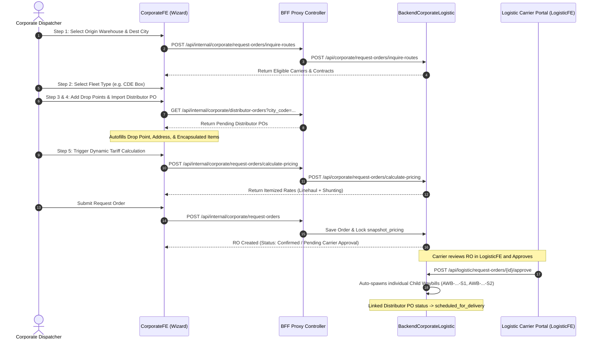

# 05. CorporateFE Request Order & Dispatch Operational Specification
## Multi-Drop Routing, Dynamic Pricing Snapshot Engine, Distributor PO Autofill & Child Waybills

> **Target Directory:** `d:\DevMuncen\CorporateFE/docs/01_preplan/05_CORPORATEFE_REQUEST_ORDER_AND_DISPATCH_SPEC.md`  
> **Backend Alignment:** `BackendCorporateLogistic` (Phases 10–14, Specs 16, 17, 20, 21, 22, 23)  
> **Key Innovations:** Encapsulated Delivery Point Items, Dynamic Route Inquiry, Tariff Snapshotting, Auto-Spawned Child Waybills, Physical Photo Proofs, and Deprecation of SiGembok.

---

## 1. Executive Summary & Paradigm Shift

In legacy systems (`Corporate-Development`), shipment orders were flat, single-destination dispatches without true multi-drop route optimization or automated child waybill spawning.

In **`CorporateFE`** and **`BackendCorporateLogistic`**, an enterprise **Request Order (RO)** represents a unified multi-drop logistics contract. A corporate shipper can dispatch a single vehicle from an origin manufacturing plant to execute multiple sequential drops across different cities or distribution hubs.



---

## 2. Multi-Drop Stop Sequencer & Delivery Point Architecture

Every drop point in `delivery_points[]` is sequentially ordered by **`stop_sequence`** (1, 2, 3...) and enforces strict destination typing:

### 2.1 Mutually Exclusive Destination Types (`delivery_type`)
```
delivery_type = 1: Corporate Warehouse Drop
  ├── corporate_warehouse_id: SET
  ├── distributor_warehouse_id: NULL
  └── customer_id: NULL

delivery_type = 2: Distributor Warehouse Drop
  ├── distributor_warehouse_id: SET
  ├── distributor_order_id: SET (Linked PO)
  ├── po_number: SET
  ├── corporate_warehouse_id: NULL
  └── customer_id: NULL (STRICTLY NOT USED FOR DISTRIBUTORS)

delivery_type = 3: B2B End-Customer Drop
  ├── customer_id: SET
  ├── corporate_warehouse_id: NULL
  └── distributor_warehouse_id: NULL
```

### 2.2 Encapsulated Product Items (`delivery_points[i].items[]`)
Products belong strictly inside their specific drop point:
- **`product_id`**: Foreign key to `corporate_products`.
- **`cargo_type_id`**: Sensitivity class (General Cargo, Cold Chain, Hazardous).
- **`quantity`**: Units to be unloaded at this stop.
- **`unit_price`**: Transfer or invoice value per unit.
- **`notes`**: Handling instructions for this specific drop.

---

## 3. Dynamic Route Inquiry & Pricing Snapshot Engine

### 3.1 Route Inquiry (`POST /api/corporate/request-orders/inquire-routes`)
Before booking, the corporate dispatcher evaluates all approved carriers with active contracts connecting the origin city and primary destination:
- Identifies active agreements in `logistic_contracts` matching `corporate_id` and `origin_city_code` $\rightarrow$ `destination_city_code`.
- Renders available transport carriers (`distribution_vendors`) with estimated vehicle availability.

### 3.2 Dynamic Tariff Breakdown & Rate Composition
When pricing is requested via `POST /api/corporate/request-orders/calculate-pricing`, the engine computes:
$$\text{Total Cost} = \text{Linehaul Rate} + \text{Outer Shunting} + \text{Inner-City Shunting} + \text{Multi-Stop Surcharges}$$
- **Linehaul (`linehaul_price`)**: Main long-haul inter-city freight rate.
- **Outer Shunting (`shunting_price`)**: Transfer cost to transit hub.
- **Inner-City Shunting (`inner_city_shunting_price`)**: Local distribution delivery fee.
- **Cargo Multiplier (`cargo_multiplier`)**: Resolves to the maximum multiplier across all encapsulated item cargo types (e.g. 1.25x for Cold Chain).

### 3.3 Immutable Tariff Snapshot (`snapshot_pricing`)
Once submitted, the calculated tariff is frozen in `snapshot_pricing` to eliminate freight price disputes:
```json
{
  "contract_id": 1,
  "price_contract_id": 101,
  "effective_date": "2026-10-15",
  "pricing_tier": "corporate_specific",
  "origin_city_code": "31.71",
  "destination_city_code": "35.78",
  "rates": {
    "linehaul_price": 3500000.00,
    "shunting_price": 450000.00,
    "inner_city_shunting_price": 250000.00,
    "subtotal_base_rate": 4200000.00
  },
  "adjustments": {
    "multi_stop_surcharge": 0.00,
    "cargo_multiplier": 1.00
  },
  "total_estimated_cost": 4200000.00
}
```

---

## 4. Distributor Order Autofill Integration

When adding a drop point destined for a distributor (`delivery_type = 2`), dispatchers can click **"Import Distributor Purchase Order"**:
1. CorporateFE queries `GET /api/internal/corporate/distributor-orders?city_code={city_code}&status=pending`.
2. A high-layer picker (`<x-modal-picker>`, `!z-[80]`) presents eligible distributor POs.
3. Upon selection:
   - `distributor_warehouse_id` is set.
   - `distributor_order_id` is linked.
   - `po_number` is populated.
   - Recipient contact name, phone, and delivery address are filled.
   - Product items, quantities, and agreed prices are automatically injected into `items[]`.
4. Submitting the Request Order transitions the linked distributor order to `scheduled_for_delivery`.

---

## 5. Child Waybills Lifecycle & Live Tracking

### 5.1 Automatic Spawning
When the carrier reviews and accepts the Request Order in `LogisticFE`, the backend automatically spawns individual **Child Waybill records (`AWB-...-S{seq}`)**, one for each delivery point.

### 5.2 Status Milestones & Real-Time Tracking
In `CorporateFE/waybills/{id}`, dispatchers monitor live progress:
1. **`confirmed`**: Request Order approved, child waybill initialized.
2. **`assigned`**: Carrier assigned driver and fleet license plate.
3. **`pickup` / `transit`**: Driver arrives at Corporate Warehouse and confirms pickup. Attaches **Bukti Pickup (`pickup_proof_photo`)**.
4. **`delivered`**: Driver completes drop at destination. Attaches **Proof of Delivery (`pod_proof_photo`)** with recipient signature.
5. **`completed`**: Once all spawned child waybills reach `delivered`, the parent Request Order status automatically updates to **`completed`**.

### 5.3 Deprecation of SiGembok Smartlocks
All previous references, hardware serial lookups, and mandatory smartlock seals have been **completely deprecated and removed** from the system. Physical verification is handled exclusively via GPS telemetry and mandatory photo proof uploads.
