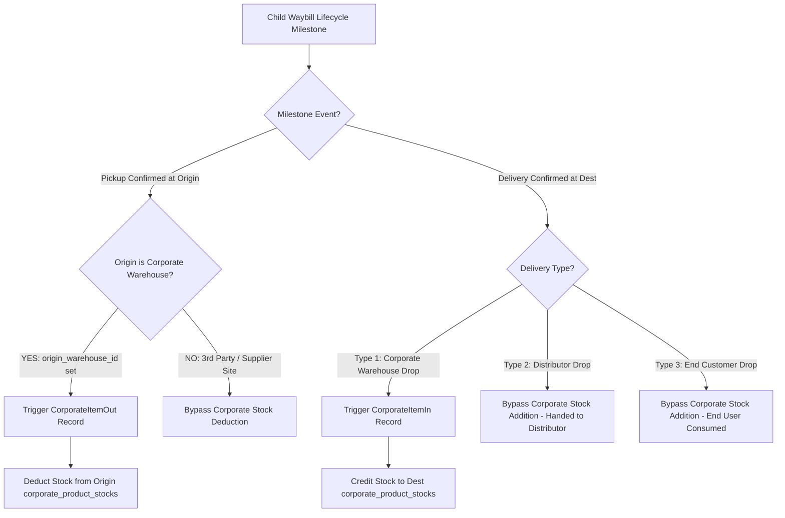

# 06. CorporateFE Inventory & Financial Billing Specification
## Stock Ledger, Conditional Automated Inventory Logging, Distributor Billing & Freight Reconciliation

> **Target Directory:** `d:\DevMuncen\CorporateFE/docs/01_preplan/06_CORPORATEFE_INVENTORY_AND_FINANCE_SPEC.md`  
> **Backend Architecture:** `BackendCorporateLogistic` (`/api/corporate/item-ins`, `/api/corporate/item-outs`, `/api/corporate/finance/*`)  
> **Key Capabilities:** Multi-Facility Stock Visibility, Pickup/Delivery-Triggered Inventory Movements, Distributor Invoicing, and Tariff Snapshot Audit Reconciliation.

---

## 1. Corporate Warehouse Inventory Architecture

Corporate clients maintain finished goods inventories across multiple manufacturing plants, regional distribution centers (RDC), and central corporate warehouses (`corporate_warehouses`).

```
+--------------------------------------------------------------------------+
|  CORPORATE INVENTORY LEDGER ARCHITECTURE                                 |
+--------------------------------------------------------------------------+
| Product SKU (corporate_products)                                         |
|    └── Warehouse Facility (corporate_warehouses)                         |
|         ├── Quantity on Hand (physical stock)                            |
|         ├── Quantity Allocated (locked in confirmed Request Orders)      |
|         └── Available for Order (Quantity on Hand - Quantity Allocated)  |
+--------------------------------------------------------------------------+
```

---

## 2. Conditional Automated Inventory Synchronization

A major breakthrough in the `BackendCorporateLogistic` architecture is **conditional, event-driven inventory logging** triggered directly by logistics shipment milestones:



### 2.1 Automated Pickup Goods Issue (`CorporateItemOut`)
- **Trigger:** Driver arrives at pickup facility and dispatcher confirms pickup (`POST /api/corporate/waybills/{id}/confirm-pickup`).
- **Condition:** Executed **ONLY IF** the order origin is an active Corporate Warehouse (`origin_warehouse_id IS NOT NULL`).
- **Result:**
  - Auto-creates an immutable `CorporateItemOut` document referencing the Waybill and parent Request Order.
  - Decrements `quantity_on_hand` in `corporate_product_stocks` for all encapsulated items at this origin.
  - Releases allocated reserve stock.
  - Bypassed cleanly if shipment origin was an external vendor or partner plant.

### 2.2 Automated Delivery Goods Receipt (`CorporateItemIn`)
- **Trigger:** Driver completes delivery and uploads proof photo (`POST /api/corporate/waybills/{id}/complete-delivery`).
- **Condition:** Executed **ONLY IF** the drop point is `delivery_type = 1` (Corporate Warehouse drop).
- **Result:**
  - Auto-creates a `CorporateItemIn` document for the receiving corporate facility.
  - Increments stock in `corporate_product_stocks` at the destination warehouse.
  - For `delivery_type = 2` (Distributor) or `delivery_type = 3` (End Customer), corporate inventory addition is **strictly bypassed** because the cargo has exited the corporate domain.

---

## 3. Manual Inventory Operations

For factory receipts, batch adjustments, and inter-branch transfers:

### 3.1 Goods Receipt (`POST /api/corporate/item-ins`)
Used when receiving finished goods batches directly from factory production lines or vendor purchases:
- Fields: `warehouse_id`, `supplier_id`, `receipt_date`, `reference_no`, `notes`.
- Items array: `product_id`, `quantity`, `unit_cost`, `batch_number`, `expiry_date`.

### 3.2 Goods Issue (`POST /api/corporate/item-outs`)
Used for damaged product disposal, sample dispatches, or offline scrap:
- Fields: `warehouse_id`, `issue_date`, `issue_type` (`scrap`, `sample`, `adjustment`), `notes`.
- Items array: `product_id`, `quantity`, `reason`.

---

## 4. Distributor Billing & Invoicing Engine (`distributor-invoices`)

Corporate enterprises issue commercial invoices to regional distributor networks for delivered product orders.

### 4.1 Form Dependencies (`GET /api/corporate/finance/distributor-invoices/form-dependencies`)
Provides required dropdown lookup data for the invoice generation modal:
- List of active distributors (`corporate_distributors`).
- List of eligible, unbilled distributor orders (`distributor_orders` with status `delivered` or `scheduled_for_delivery`).
- Bank account details for corporate remittance.

### 4.2 Invoice Generation (`POST /api/corporate/finance/distributor-invoices`)
- Allows bundling one or multiple distributor purchase orders into a single tax invoice.
- Automatically calculates:
  - Gross Subtotal ($\sum \text{quantity} \times \text{unit\_price}$)
  - Distributor Trade Discount (percent or lump sum)
  - Value Added Tax (PPN 11%)
  - Total Invoice Amount Due
- Sets payment terms (e.g. Net 30, Net 60).

### 4.3 Payment Tracking Lifecycle
In `CorporateFE/finance/distributor-invoices`:
- **`unpaid`**: Invoice generated and dispatched to distributor.
- **`partial`**: Partial payment recorded with bank transaction reference.
- **`paid`**: Invoice fully settled.
- **`overdue`**: Current date exceeds payment term due date without full settlement.

---

## 5. Freight Invoice Reconciliation

CorporateFE monitors transport carrier invoices to ensure corporate shippers are billed exactly according to contract terms:
1. When a freight carrier submits an invoice (`/api/corporate/invoices`), the system links it to the parent `request_orders` record.
2. The UI automatically displays a **Tariff Parity Check**:
   - **Contract Locked Fee:** Extracted from `snapshot_pricing.total_estimated_cost`.
   - **Carrier Billed Fee:** Value submitted on carrier invoice.
   - **Variance Indicator:** Highlights any discrepancy or unauthorized surcharge in real-time.
3. If variance is zero, corporate finance can approve the invoice for disbursement with one click.
