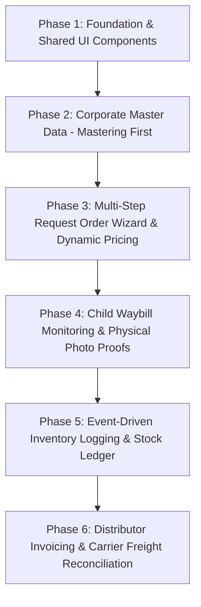

# 🏢 CorporateFE Front-End System Requirements Summary
## Consolidated Requirements, Tech Stack Standards & Sequential Architecture Roadmap

> **Target Directory:** `d:\DevMuncen\CorporateFE`  
> **Backend Architecture:** `d:\DevMuncen\BackendCorporateLogistic` (`/api/corporate/*`, `/api/master/*`, `/api/auth/*`)  
> **Base Engine:** Laravel 12 + Tailwind CSS v4 + Preline UI + Vanilla JS BFF Engine (Parity with `LogisticFE` & `AgregatorFE`)  
> **Tenant Identity:** Corporate Shipper (`tenant_corporate_id: 1`, `Korporasi Merah Putih`)

---

## 1. System Technology Stack Parameters

| Layer | Technology / Standard | Specification & Role |
| :--- | :--- | :--- |
| **Framework** | Laravel 12 + PHP 8.2+ | Headless Frontend Web Engine with Blade View Components |
| **Styling & Theme** | Tailwind CSS v4 + Preline UI | Corporate Navy (`#1E3A8A`), Deep Corporate (`#102A5C`), Sky Blue (`#60A5FA`) |
| **Asset Bundler** | Vite 7 (`@tailwindcss/vite`) | Ultra-fast HMR and production asset compilation |
| **BFF Proxy Model** | Server-to-Server (S2S) Proxy | Client AJAX targets `/api/internal/corporate/*`; Proxy injects Sanctum Bearer & `X-Tenant-Corporate-ID` |
| **Session Security** | Encrypted Laravel Session | Tokens strictly prohibited from `localStorage` or browser cookies |
| **Modal Stacking** | Unconstrained Stacking | Zero trapped `z-10` contexts. Backdrop: `!z-[40]`, Modals: `!z-[60]`, Pickers: `!z-[80]`, Toasts: `!z-[100]` |
| **Default Ports** | `CorporateFE`: **8004** | Target API: `BackendCorporateLogistic` on port **8001** |

---

## 2. Core Functional Requirements Order

### Requirement 1: Master Data Foundation (Mastering First)
* **Corporate Products & Catalog (`/products`)**: SKU codes, product names, categories (`/product-categories`), units of measure (`/uoms`), and mandatory cargo type classifications (`cargo_type_id`: General, Cold Chain, Hazmat).
* **Corporate Facilities & Plants (`/warehouses`)**: Factory hubs with Kemendagri city codes and `is_pickup_hub` status flags.
* **Corporate B2B Customers (`/customers`)**: Retail distribution destinations and receiving PIC contacts.
* **Distributor Network (`/distributors`)**: Regional distributor hubs and branches.
* **Supply Vendors (`/vendors`)**: Raw materials and packaging suppliers.

### Requirement 2: 5-Step Request Order Wizard & Dynamic Pricing Engine (`/request-orders/create`)
* **Step 1: Origin & Carrier Route Inquiry**: Select pickup facility (`is_pickup_hub = true`), primary destination city, and trigger `POST /inquire-routes` to list eligible carriers.
* **Step 2: Fleet Type Selection**: CDE, CDD, Fuso, or Wingbox with active capacity constraint meter.
* **Step 3: Multi-Drop Stop Sequencer**: Add 1..$N$ delivery points with sequential `stop_sequence` and mutually exclusive destination type switcher (`1 = Corporate WH`, `2 = Distributor WH`, `3 = Customer`).
* **Step 4: Encapsulated Items & Distributor PO Autofill**: Add product rows under each drop. 1-Click "Import Distributor PO" auto-populates recipient details and item rosters.
* **Step 5: Dynamic Tariff Review & Locking**: Call `POST /calculate-pricing` to render Linehaul + Outer Shunting + Inner Shunting rates, and lock calculation into `snapshot_pricing`.

### Requirement 3: Child Waybill Tracking & Physical Proof Verification (`/waybills`)
* **Auto-Spawned Child Waybills**: Approving an RO automatically spawns individual `AWB-...-S{seq}` waybills for each drop point.
* **Visual Milestone Tracker**: Live progress timeline from pickup to final recipient delivery.
* **Photo Proof Uploads**: Bukti Pickup (`pickup_proof_photo`) and Proof of Delivery (`pod_proof_photo`).
* **SiGembok Deprecation**: Complete removal of smartlock dependencies.

### Requirement 4: Event-Driven Inventory Synchronization (`/inventory`)
* **Real-Time Stock Ledger (`/inventory/stocks`)**: Multi-warehouse quantity on hand, allocated reserves, and available balances.
* **Automated Item Out (`CorporateItemOut`)**: Auto-deducts stock upon carrier pickup if origin is a Corporate Warehouse.
* **Automated Item In (`CorporateItemIn`)**: Auto-credits stock upon carrier delivery if drop point is a Corporate Warehouse.
* **Manual Goods Movement**: Record factory inbound receipts (`/inventory/item-ins`) and warehouse scrap/sample issues (`/inventory/item-outs`).

### Requirement 5: Distributor Billing & Freight Reconciliation (`/finance`)
* **Distributor Commercial Invoices (`/finance/distributor-invoices`)**: Issue tax invoices for delivered distributor orders; payment status tracking (`unpaid`, `partial`, `paid`, `overdue`); PDF export.
* **Carrier Freight Reconciliation (`/finance/corporate-invoices`)**: Automated parity check comparing carrier freight billings against frozen `snapshot_pricing.total_estimated_cost`.

---

## 3. Pre-Implementation Documentation Suite Index

| Doc Index | File Path | Scope & Focus |
| :---: | :--- | :--- |
| **Master Spec** | [`CORPORATEFE_MASTER_SPECIFICATION.md`](CORPORATEFE_MASTER_SPECIFICATION.md) | High-level architectural blueprint, multi-stop lifecycle sequence diagrams. |
| **Summary** | [`CORPORATEFE_FRONTEND_REQUIREMENTS_SUMMARY.md`](CORPORATEFE_FRONTEND_REQUIREMENTS_SUMMARY.md) | Tech stack parameters, functional ordering, and document index. |
| **Preplan 01** | [`01_preplan/01_CORPORATEFE_PREPLAN.md`](01_preplan/01_CORPORATEFE_PREPLAN.md) | Multi-tenant BFF proxy pattern, S2S headers (`X-Tenant-Corporate-ID`), and session security. |
| **Preplan 02** | [`01_preplan/02_CORPORATEFE_MASTER_DATA_SPEC.md`](01_preplan/02_CORPORATEFE_MASTER_DATA_SPEC.md) | Master Data Prerequisites: Products, Warehouses, Customers, Kemendagri city codes. |
| **Preplan 03** | [`01_preplan/03_CORPORATEFE_TEMPLATE_MAPPING.md`](01_preplan/03_CORPORATEFE_TEMPLATE_MAPPING.md) | Blade component architecture, layout slicing, 5-Step RO Wizard, and modal pickers. |
| **Preplan 04** | [`01_preplan/04_CORPORATEFE_API_CONTRACTS.md`](01_preplan/04_CORPORATEFE_API_CONTRACTS.md) | Complete internal BFF Proxy API contracts specification (`/api/internal/corporate/*`). |
| **Preplan 05** | [`01_preplan/05_CORPORATEFE_REQUEST_ORDER_AND_DISPATCH_SPEC.md`](01_preplan/05_CORPORATEFE_REQUEST_ORDER_AND_DISPATCH_SPEC.md) | Deep-dive on multi-drop RO Wizard, dynamic pricing snapshotting, and child waybills. |
| **Preplan 06** | [`01_preplan/06_CORPORATEFE_INVENTORY_AND_FINANCE_SPEC.md`](01_preplan/06_CORPORATEFE_INVENTORY_AND_FINANCE_SPEC.md) | Event-driven inventory sync (Item In / Item Out), distributor billing, and freight auditing. |
| **Preplan 07** | [`01_preplan/07_GAP_ANALYSIS_AND_ENHANCEMENTS.md`](01_preplan/07_GAP_ANALYSIS_AND_ENHANCEMENTS.md) | Comparative analysis: Legacy CI4 `Corporate-Development` vs Modern `CorporateFE`. |
| **Checklist 01**| [`02_implementation/01_CORPORATEFE_IMPLEMENTATION_CHECKLIST.md`](02_implementation/01_CORPORATEFE_IMPLEMENTATION_CHECKLIST.md) | Master 7-Phase implementation tracking checklist. |
| **Checklist 02**| [`02_implementation/02_BACKEND_SYNC_AND_VERIFICATION_CHECKLIST.md`](02_implementation/02_BACKEND_SYNC_AND_VERIFICATION_CHECKLIST.md) | Backend endpoint parity and verification matrix. |
| **Design 00** | [`00_design/COLOR BRAND GUIDELINE.md`](00_design/COLOR%20BRAND%20GUIDELINE.md) | Corporate Navy (`#1E3A8A`) enterprise brand system, tokens, and z-index hierarchy. |
