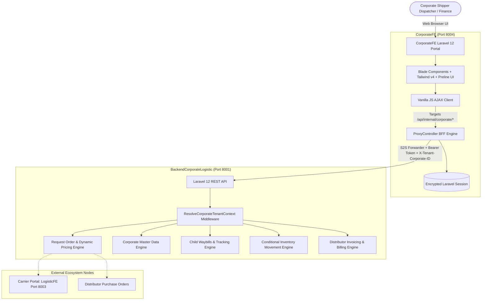

# 🏢 CorporateFE Master System Specification
## High-Level Architectural Blueprint, Operational Lifecycle & Frontend Engineering Standards

> **Target Repository:** `d:\DevMuncen\CorporateFE`  
> **Backend API Engine:** `d:\DevMuncen\BackendCorporateLogistic`  
> **Architecture Pattern:** Backend-For-Frontend (BFF) Proxy with S2S Sanctum Authentication & Tenant Scoping  
> **Brand Theme:** Corporate Navy (`#1E3A8A`) & Enterprise Blue (`#3155A6`)

---

## 1. System Architecture Overview

**`CorporateFE`** is the dedicated enterprise web operations and management portal for **Corporate Shippers (Prinsipal Korporasi / FMCG Manufaktur)**. It provides complete digital visibility and execution across master data, freight booking, shipment tracking, inventory synchronization, and distributor financial settlement.



---

## 2. Foundational Prerequisite: Master Data Architecture

Before booking shipments, corporate master entities must be configured with full tenant ownership (`corporate_id`):

1. **Product Catalog (`corporate_products`)**:
   - Master SKU, product category, unit of measure (`uom_id`).
   - Mandatory **Cargo Type Classification (`cargo_type_id`)**: General Cargo, Cold Chain / Perishable, Hazardous, or Fragile.
   - Base MSRP and unit volumetric weights.
2. **Corporate Warehouses & Manufacturing Plants (`corporate_warehouses`)**:
   - Physical production plants, central hubs, and regional distribution centers.
   - Kemendagri city/regency codes (`city_code` e.g. `31.71` Jakarta Pusat, `32.16` Kab. Bekasi).
   - **Pickup Hub Status (`is_pickup_hub`)**: Only warehouses flagged as pickup hubs can originate Request Orders.
3. **Corporate Customers (`corporate_customers`)**:
   - B2B delivery recipients and modern retail networks.
4. **Corporate Distributors (`corporate_distributors`)**:
   - Regional distributor partner networks and warehouse branches.

---

## 3. Operational Lifecycle: The End-to-End Shipment Journey

```mermaid
sequenceDiagram
    autonumber
    participant C as Corporate Dispatcher
    participant WZ as 5-Step RO Wizard
    participant API as BackendCorporateLogistic
    participant L as Carrier (LogisticFE)
    participant D as Driver Mobile App

    Note over C,WZ: 1. Booking & Pricing Phase
    C->>WZ: Step 1: Select Origin Warehouse & Dest Primary City
    WZ->>API: POST /request-orders/inquire-routes
    API-->>WZ: Eligible Carriers & Agreed Rate Contracts
    C->>WZ: Step 2: Select Fleet Type (CDE / CDD / Fuso / Wingbox)
    C->>WZ: Step 3 & 4: Configure Sequential Drop Points & Encapsulated Items
    WZ->>API: GET /distributor-orders?city_code=...
    API-->>WZ: Return Pending Distributor Orders
    Note over WZ: 1-Click Autofills Drop Point & Products
    C->>WZ: Step 5: Dynamic Tariff Review
    WZ->>API: POST /request-orders/calculate-pricing
    API-->>WZ: Itemized Rates (Linehaul + Shunting + Adjustments)
    C->>WZ: Submit Request Order
    WZ->>API: POST /request-orders (Locks snapshot_pricing)

    Note over API,L: 2. Carrier Review & Waybill Spawning
    API-->>L: Alert: Incoming Request Order in LogisticFE
    L->>API: POST /api/logistic/request-orders/{id}/approve
    API->>API: Auto-spawns Child Waybills (AWB-...-S1, AWB-...-S2)
    Note over API: Linked Distributor PO status -> scheduled_for_delivery

    Note over L,D: 3. Execution & Inventory Triggers
    L->>API: POST /api/logistic/deliveries (Assign Fleet & Driver)
    D->>API: POST /confirm-pickup (Attaches pickup_proof_photo)
    API->>API: AUTO-TRIGGER: CorporateItemOut (Deducts Origin Stock)
    D->>API: POST /complete-delivery (Attaches pod_proof_photo)
    alt Destination is Corporate Warehouse (Type 1)
        API->>API: AUTO-TRIGGER: CorporateItemIn (Credits Dest Stock)
    else Destination is Distributor / Customer (Type 2 / 3)
        Note over API: Handed off; Corporate stock unchanged
    end

    Note over API,C: 4. Completion & Billing
    API->>API: All Child Waybills Delivered -> RO Status: completed
    C->>API: Issue Distributor Commercial Invoice (finance/distributor-invoices)
    C->>API: Reconcile Carrier Freight Invoice vs snapshot_pricing
```

---

## 4. Key Architectural Standards & Innovations

### 4.1 Encapsulated Delivery Points (`delivery_points[].items[]`)
- Obsoleted flat top-level items. Each product item is strictly bound to its destination drop.
- Sequential ordering via `stop_sequence` (1, 2, 3...).
- Mutually exclusive destination typing (`delivery_type`: 1 = Corporate WH, 2 = Distributor WH, 3 = Customer).

### 4.2 Dynamic Pricing Snapshot Engine (`snapshot_pricing`)
- Replaces legacy hardcoded rate lookups.
- Calculates Linehaul Rate, Outer Shunting, Inner-City Shunting, and Cargo Handling Multipliers in real-time.
- Stores frozen calculation in JSON upon submission to guarantee 100% invoice reconciliation parity.

### 4.3 1-Click Distributor Purchase Order Autofill
- Connects corporate outbound dispatches directly to incoming distributor demand (`distributor_orders`).
- Automatically imports delivery address, contact info, and product quantities into active drop points.

### 4.4 Event-Driven Conditional Inventory Logging
- Automatically creates `CorporateItemOut` and deducts inventory when a carrier picks up cargo from a Corporate Warehouse.
- Automatically creates `CorporateItemIn` and credits inventory when a carrier drops cargo at a destination Corporate Warehouse.
- Bypasses corporate inventory additions cleanly when cargo is handed to distributors or end-customers.

### 4.5 Deprecation of SiGembok Hardware Seals
- Physical smartlock seals are completely removed.
- Shipment integrity is verified via real-time GPS telemetry and mandatory photo proof uploads: **Bukti Pickup (`pickup_proof_photo`)** and **Proof of Delivery (`pod_proof_photo`)**.

---

## 5. UI Layout, Stacking & Theming Standards

- **Color Brand:** Corporate Navy (`#1E3A8A`), Deep Corporate (`#102A5C`), Enterprise Blue (`#3155A6`), Sky Blue (`#60A5FA`).
- **Unconstrained Stacking Hierarchy:**
  - Zero trapped `z-10` contexts on `.page-wrapper`.
  - `.hs-overlay-backdrop`: `!z-[40]`
  - Modal Dialogs (`<x-modal>`): `!z-[60]`
  - Relational Pickers (`<x-modal-picker>`): `!z-[80]`
  - Notifications & Toasts (`<x-toast>`): `!z-[100]`
